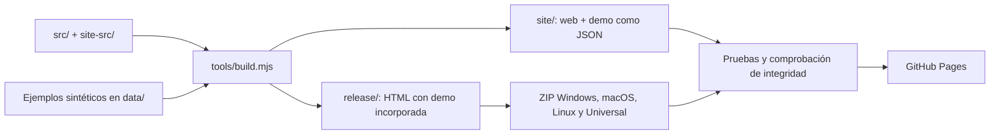
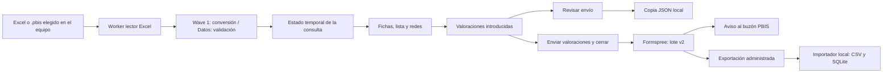

# Arquitectura de PBIS

Estado revisado el 16 de octubre de 2026. Las flechas distinguen construcción, consulta local y envío voluntario de valoraciones.

## Construcción y distribución

Las ediciones comparten fuentes; `release/PBIS.html` es un resultado generado, no una tercera plantilla editable. Los cuatro ZIP contienen HTML y recursos, no binarios nativos.

`site/` y `release/` se generan y están excluidos de Git. Las cuatro direcciones de descarga se conservan por compatibilidad; una persona descarga solo el paquete que elija. Para una entrega local más pequeña, `tools/empaquetar_entrega.py --tipo aplicacion` incluye una sola copia del visualizador, el inicio y las licencias, sin fuentes ni Excel separados. El modo predeterminado `proyecto` conserva los materiales necesarios para reconstruir y probar.

La publicación excluye los Excel de ejemplo y la llave sintética como archivos sueltos. Los ejemplos continúan en `data/examples/` para desarrollo y la demo permanece incorporada. No se borran archivos de usuarios ni copias anteriores; retirar un archivo de una construcción futura no elimina versiones remotas o respaldos anteriores.

### Carpeta estática unificada

`tools/distribuir_estatico.py` genera, por separado, un portal index.html y una única aplicación app.html idéntica a release/PBIS.html. La demo está incorporada: no se intenta cargar un JSON mediante fetch desde file://. PBIS.html y DEMO.html son redirecciones menores de 1 kB, no copias de la aplicación. assets/ conserva la identidad visual y docs/ agrupa la guía de uso, lectura, privacidad y valoraciones en dos representaciones del mismo manual, además de las licencias. downloads/PBIS.zip contiene una sola copia del motor para uso local.

Esta distribución no modifica la construcción histórica de site/ ni borra fuentes. Mantener Node y Python como herramientas de desarrollo no implica desplegar un backend. Una poda de release/, outputs/ y documentación no construiría esta estructura y podría eliminar material útil o romper las instrucciones. La concordancia de cálculos con R no convierte por sí sola una entrega estática en un producto certificado para producción.

## Consulta y valoraciones

El Excel completo y los nombres no se adjuntan al envío. El lote sí contiene los códigos de referencia, la cuenta utilizada y los valores concretos valorados; por eso no se describe como anónimo. La demo no alcanza el receptor.

`feedback-service/` es otro componente opcional, con un contrato de opinión individual, SQLite y correo mediante Resend. No recibe los lotes de la web actual. Su validación individual comparte `src/feedback-model.js`, pero sus datos persistidos y el estado temporal del navegador tienen ciclos de vida distintos.

El lector usa `new Worker(URL.createObjectURL(new Blob(...)))` con SheetJS y el parser incorporados. El worker de exportación de opiniones está desactivado en el modo actual de lotes; cuando se usa, también se crea desde un Blob. La política CSP permite esos workers y restringe las conexiones al receptor configurado. `linked-feedback.js` prepara los registros: el envío efectivo del lote está en `app.js`. Retirar ese módulo rompería la preparación del feedback, no eliminaría un servidor desplegado.
